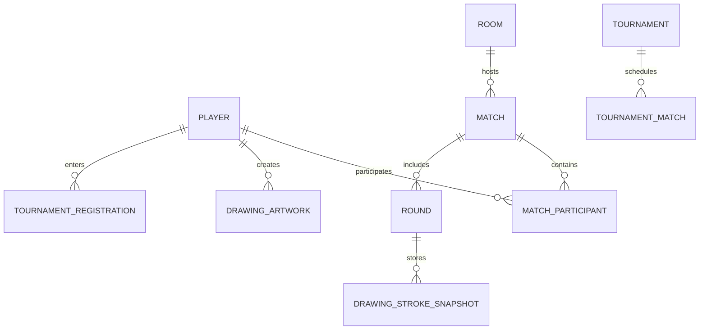

# Database Schema — Doodle Arena

Doodle Arena implements a clean relational schema compatible with SQLite and PostgreSQL.

---

## 1. Entity-Relationship Overview



---

## 2. Table Definitions (SQL DDL)

### `players`
Stores persistent player identities, ranks, ratings, and stats.
```sql
CREATE TABLE IF NOT EXISTS players (
  id TEXT PRIMARY KEY,
  nickname TEXT NOT NULL,
  avatar_style TEXT NOT NULL DEFAULT 'cat',
  avatar_hat TEXT DEFAULT 'beret',
  avatar_color TEXT NOT NULL DEFAULT '#7C3AED',
  level INTEGER NOT NULL DEFAULT 1,
  xp INTEGER NOT NULL DEFAULT 0,
  elo_rating INTEGER NOT NULL DEFAULT 1200,
  rank_tier TEXT NOT NULL DEFAULT 'Silver I',
  total_games INTEGER NOT NULL DEFAULT 0,
  total_wins INTEGER NOT NULL DEFAULT 0,
  perfect_drawings INTEGER NOT NULL DEFAULT 0,
  fastest_guess_ms INTEGER DEFAULT NULL,
  created_at TIMESTAMP DEFAULT CURRENT_TIMESTAMP,
  updated_at TIMESTAMP DEFAULT CURRENT_TIMESTAMP
);
```

### `rooms`
Active and archived room configurations.
```sql
CREATE TABLE IF NOT EXISTS rooms (
  id TEXT PRIMARY KEY,
  code TEXT UNIQUE NOT NULL,
  is_private BOOLEAN NOT NULL DEFAULT 0,
  host_id TEXT NOT NULL,
  max_players INTEGER NOT NULL DEFAULT 8,
  rounds INTEGER NOT NULL DEFAULT 3,
  draw_time_seconds INTEGER NOT NULL DEFAULT 80,
  difficulty TEXT NOT NULL DEFAULT 'medium',
  word_pack_id TEXT NOT NULL DEFAULT 'classic',
  status TEXT NOT NULL DEFAULT 'lobby', -- 'lobby', 'in_game', 'completed', 'abandoned'
  created_at TIMESTAMP DEFAULT CURRENT_TIMESTAMP
);
```

### `matches`
Complete record of executed multiplayer matches.
```sql
CREATE TABLE IF NOT EXISTS matches (
  id TEXT PRIMARY KEY,
  room_id TEXT NOT NULL,
  mode TEXT NOT NULL DEFAULT 'casual', -- 'casual', 'ranked', 'tournament', 'duel'
  total_rounds INTEGER NOT NULL,
  winner_id TEXT,
  started_at TIMESTAMP DEFAULT CURRENT_TIMESTAMP,
  ended_at TIMESTAMP,
  FOREIGN KEY (room_id) REFERENCES rooms(id)
);
```

### `match_participants`
Final scores and stats per participant in a match.
```sql
CREATE TABLE IF NOT EXISTS match_participants (
  id TEXT PRIMARY KEY,
  match_id TEXT NOT NULL,
  player_id TEXT NOT NULL,
  final_score INTEGER NOT NULL DEFAULT 0,
  final_rank INTEGER NOT NULL DEFAULT 1,
  correct_guesses INTEGER NOT NULL DEFAULT 0,
  drawing_rounds INTEGER NOT NULL DEFAULT 0,
  elo_change INTEGER DEFAULT 0,
  FOREIGN KEY (match_id) REFERENCES matches(id)
);
```

### `drawing_artworks`
Saved match gallery drawings.
```sql
CREATE TABLE IF NOT EXISTS drawing_artworks (
  id TEXT PRIMARY KEY,
  match_id TEXT NOT NULL,
  round_number INTEGER NOT NULL,
  drawer_id TEXT NOT NULL,
  secret_word TEXT NOT NULL,
  category TEXT NOT NULL,
  stroke_count INTEGER NOT NULL,
  data_url TEXT NOT NULL, -- Compressed SVG or vector JSON
  likes_count INTEGER NOT NULL DEFAULT 0,
  created_at TIMESTAMP DEFAULT CURRENT_TIMESTAMP,
  FOREIGN KEY (match_id) REFERENCES matches(id)
);
```

### `tournaments` & `tournament_matches`
Tournament bracket state and scheduled match progression.
```sql
CREATE TABLE IF NOT EXISTS tournaments (
  id TEXT PRIMARY KEY,
  title TEXT NOT NULL,
  stage TEXT NOT NULL DEFAULT 'quarterfinals',
  status TEXT NOT NULL DEFAULT 'live',
  prize_pool TEXT NOT NULL,
  max_participants INTEGER NOT NULL DEFAULT 16,
  created_at TIMESTAMP DEFAULT CURRENT_TIMESTAMP
);

CREATE TABLE IF NOT EXISTS tournament_matches (
  id TEXT PRIMARY KEY,
  tournament_id TEXT NOT NULL,
  bracket_round TEXT NOT NULL, -- 'round_16', 'quarterfinals', 'semifinals', 'finals'
  match_index INTEGER NOT NULL,
  player1_id TEXT,
  player1_name TEXT,
  player1_score INTEGER DEFAULT 0,
  player2_id TEXT,
  player2_name TEXT,
  player2_score INTEGER DEFAULT 0,
  winner_id TEXT,
  status TEXT NOT NULL DEFAULT 'upcoming', -- 'live', 'upcoming', 'completed'
  room_code TEXT,
  FOREIGN KEY (tournament_id) REFERENCES tournaments(id)
);
```
