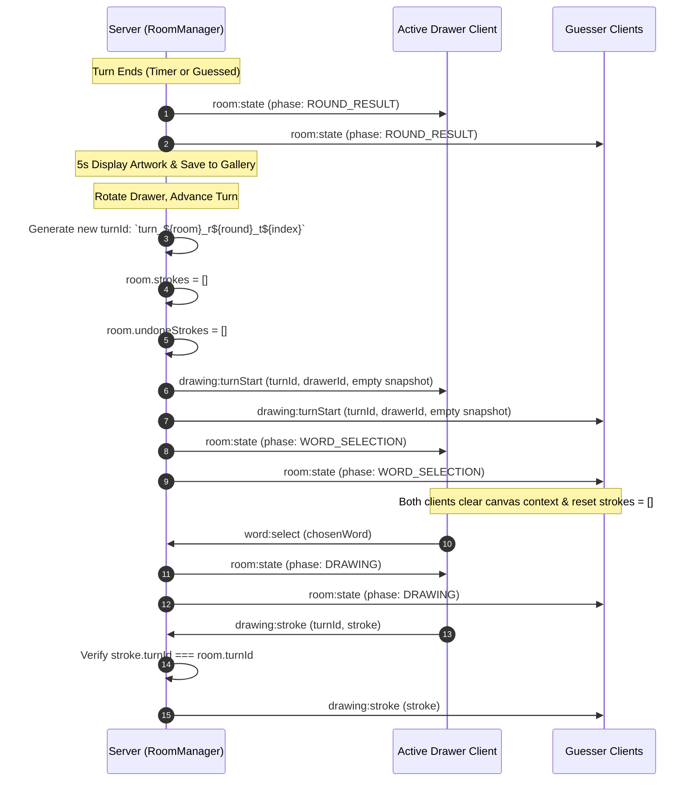

# Doodle Arena — Drawing Lifecycle Audit (Phases 0–4)
**Document Version:** 1.0.0  
**Audit Date:** November 2026  
**Auditor:** Canvas Engine & Real-Time Graphics Systems Team  
**Scope:** Canvas Lifecycle, Turn Boundaries, Stroke Protocol, Undo/Redo Stacks, Coordinate Systems, Cross-Client Synchronization

---

## 1. Executive Summary

The primary functional blocker identified in Doodle Arena is that the drawing canvas fails to reset between turns: when a round finishes and turn rotates to the next drawer, the previous player's artwork remains rendered on the canvas for all participants.

This audit provides a line-level technical diagnosis of why this breakdown occurs, details the flaw in state propagation between `RoomManager.ts`, `App.tsx`, and `DrawingCanvas.tsx`, and defines the authoritative drawing lifecycle protocol required to guarantee clean turn resets.

---

## 2. Root Cause Analysis of Canvas Reset Failure

### 2.1 The Asymmetric State Reset Flaw

The failure is caused by an asymmetric state reset between the server in-memory room model and the client-side React rendering tree:

```
[SERVER: RoomManager.ts]
  ├── startWordSelection()
  │     ├── room.strokes = [];           <-- Cleared in Node.js heap memory!
  │     ├── room.undoneStrokes = [];
  │     └── this.broadcastRoomState();   <-- Emits 'room:state' payload
  │
  └── (CRITICAL OMISSION)
        └── Does NOT emit 'drawing:cleared'
        └── Does NOT emit 'drawing:snapshot' with empty array []
        └── Does NOT attach strokes to 'room:state' payload
```

```
[CLIENT: App.tsx]
  ├── socket.on('room:state', (state) => {
  │     setRoomState(state);             <-- Only updates room metadata!
  │     // (CRITICAL OMISSION)
  │     // strokes state is NOT cleared here!
  │   });
  │
  ├── socket.on('drawing:cleared', ...)  <-- Listener exists, but NEVER called by server!
  └── socket.on('drawing:snapshot', ...) <-- Listener exists, but NEVER called on turn change!
```

```
[CLIENT: DrawingCanvas.tsx]
  ├── Receives `strokes` prop from App.tsx
  └── redraw() iterates over all strokes in `strokes` prop:
        Since `strokes` still contains Turn 1 strokes, Turn 1 remains on screen!
```

### 2.2 Lack of Authoritative Turn Scoping

Strokes currently carry only an arbitrary client-generated `id`, `tool`, `color`, `size`, `points`, and `seq`.
There is no `turnId`, `roundNumber`, or `drawerId` attached to a stroke:

```ts
// Existing Stroke interface in shared/types.ts:
export interface Stroke {
  id: string;
  tool: DrawingTool;
  color: string;
  size: number;
  points: Point[];
  seq: number;
  timestamp?: number;
}
```

Because strokes lack a `turnId`:
1. If a client transmits a stroke packet with network jitter right as the round expires, the server accepts it into the new turn or broadcasts it to clients during word selection.
2. The client cannot distinguish whether an incoming stroke belongs to the active turn or an expired turn.

---

## 3. Authoritative Turn Lifecycle Protocol

To guarantee mathematical separation between turns, the drawing lifecycle must adhere to the following sequence:

### 3.1 Turn Transition Protocol Sequence



---

## 4. Canvas Resolution & Coordinate Normalization

### 4.1 Logical Coordinate Space
- Standard Canvas Resolution: **1200 × 900 pixels** (4:3 aspect ratio).
- All drawing points `(x, y)` are strictly normalized to this `1200 × 900` grid regardless of whether the user is on a mobile device, tablet, or desktop monitor.

### 4.2 Coordinate Calculation Precision
In `src/components/canvas/DrawingCanvas.tsx`:
```ts
const getCoordinates = (e: React.PointerEvent<HTMLCanvasElement>): Point => {
  const canvas = canvasRef.current;
  if (!canvas) return { x: 0, y: 0 };
  const rect = canvas.getBoundingClientRect();
  const scaleX = LOGICAL_WIDTH / rect.width;
  const scaleY = LOGICAL_HEIGHT / rect.height;
  return {
    x: Math.round((e.clientX - rect.left) * scaleX),
    y: Math.round((e.clientY - rect.top) * scaleY),
    pressure: e.pressure || 0.5,
  };
};
```
This guarantees pixel-perfect parity between what the drawer sketches and what guessers render.

---

## 5. Undo / Redo Lifecycle Specifications

1. **Stack Ownership:** The undo/redo history belongs strictly to the active turn.
2. **Turn Boundary Isolation:**
   - When `turnStart` occurs, `room.undoneStrokes = []` and `room.strokes = []`.
   - Incoming `drawing:undo` or `drawing:redo` requests must verify:
     `socket.playerId === room.currentDrawerId && room.phase === 'DRAWING'`.
3. **Synchronized Event Distribution:**
   - When undo succeeds, server broadcasts `drawing:undo { strokeId }`.
   - When redo succeeds, server broadcasts `drawing:redo { stroke }`.
   - When clear canvas is triggered, server resets `room.strokes = []` and broadcasts `drawing:cleared {}`.

---

## 6. Implementation Changes Required

1. **`shared/types.ts`:**
   - Add `turnId: string` to `RoomState`.
   - Add `turnId?: string` to `Stroke`.
2. **`server/game/RoomManager.ts`:**
   - Generate authoritative `turnId` in `startWordSelection()`.
   - Emit `drawing:turnStart` containing `{ turnId, drawerId, strokes: [] }` to the entire room whenever a turn rotates.
   - Emit `drawing:cleared` whenever a turn begins.
   - Enforce `stroke.turnId === room.turnId` validation in `handleDrawingStroke()`.
3. **`src/App.tsx`:**
   - Listen to `drawing:turnStart` and immediately set `strokes = []`.
   - In `room:state` listener, check if `state.turnId !== currentTurnIdRef.current`; if changed, immediately set `strokes = []`.
   - Pass `turnId` in outgoing strokes.
