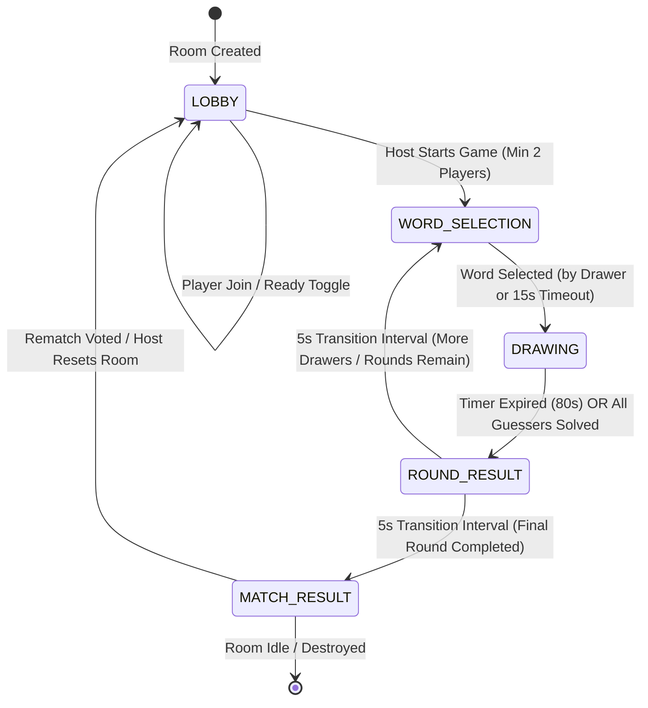

# Doodle Arena — Game State Audit (Phases 0–4)
**Document Version:** 1.0.0  
**Audit Date:** November 2026  
**Auditor:** Real-Time Game State & Systems Architecture Team  
**Scope:** Server-Authoritative State Machine, Phase Transitions, Concurrency Locks, Timer Lifecycles, Scoring Models

---

## 1. Executive Summary

Doodle Arena employs a server-authoritative architecture where all critical game state—including player roles, active drawers, secret words, timer bounds, score calculations, and turn rotation—is managed in `server/game/RoomManager.ts`.

This audit rigorously evaluates the state machine transitions, reveals critical race conditions in round completion, analyzes timer lifecycles, and outlines the required idempotency guarantees.

---

## 2. State Machine Architecture

### 2.1 State Flow Diagram



### 2.2 Phase Specifications

| Phase | Duration | Authoritative Server Action | Allowed Client Actions |
|---|---|---|---|
| `LOBBY` | Indefinite | Room config, player slot assignment, readiness check | Change avatar, toggle ready, update room settings (host only), start game |
| `WORD_SELECTION` | 15s | Generates 3 tiered words; schedules auto-selection fallback | Active drawer emits `word:select`; other players wait in lobby |
| `DRAWING` | 60–80s | Runs 1Hz authoritative timer, evaluates hints, validates guesses, awards points | Drawer emits `drawing:stroke`, `undo`, `redo`, `clear`; Guessers emit `guess:submit` |
| `ROUND_RESULT` | 5s | Reveals secret word, awards drawer bonus, saves artwork, schedules rotation | View round recap, like artwork |
| `MATCH_RESULT` | Indefinite | Computes final podium standings, awards ELO & XP, saves match to database | Vote rematch, view podium, navigate to lobby |

---

## 3. Concurrency & Race Condition Analysis

### 3.1 Unprotected Concurrent `endRound()` Invocations
- **Vulnerability Identified in `RoomManager.ts`:**
  `endRound(room, reason)` is invoked from two asynchronous sources:
  1. The 1-second interval timer tick:
     ```ts
     if (remainingMs <= 0) {
       if (room.timerInterval) clearInterval(room.timerInterval);
       this.endRound(room, 'Time is up!');
     }
     ```
  2. The guess submission handler when all non-drawing players have guessed correctly:
     ```ts
     if (allGuessed && totalGuessers.length > 0) {
       this.broadcastSystemMessage(room, 'All doodlers solved the word!');
       if (room.timerInterval) clearInterval(room.timerInterval);
       this.endRound(room, 'All doodlers solved the word!');
     }
     ```
- **Hazard:**
  If the final correct guess is processed when `remainingMs` is near 0, both execution branches fire concurrently before `room.phase` is checked.
  Because each call schedules an unmanaged `setTimeout(..., 5000)` to advance the turn:
  - `room.drawerIndex` increments twice.
  - One player's turn is skipped completely.
  - Scores are calculated and credited twice to the drawer.
  - Artwork is saved twice to the database.

- **Required Resolution:**
  Implement an atomic phase guard and single transition lock:
  ```ts
  if (room.phase !== 'DRAWING') {
    return; // Reject re-entrant endRound calls
  }
  room.phase = 'ROUND_RESULT'; // Immediately mutate phase to lock out concurrent triggers
  if (room.timerInterval) {
    clearInterval(room.timerInterval);
    room.timerInterval = null;
  }
  ```

---

### 3.2 Turn Lifecycle & Turn ID Tracking
- **Defect Identified:**
  Currently, turns are tracked only by an integer `drawerIndex` and `currentRound`.
  There is no unique `turnId`.
- **Consequences:**
  1. Strokes cannot be validated against the active turn.
  2. Undo/redo actions can modify stale or cross-turn strokes.
  3. Clients cannot reliably detect whether a received state update belongs to a new turn or the current turn.
- **Required Specification:**
  Every turn must generate an authoritative immutable `turnId`:
  ```ts
  room.turnId = `turn_${room.code}_r${room.currentRound}_t${room.drawerIndex}_${Date.now()}`;
  ```
  Every stroke and canvas event must carry this `turnId`. Strokes with a mismatched `turnId` must be discarded immediately.

---

### 3.3 Word Selection Timeout Race
- **Vulnerability Identified:**
  In `RoomManager.ts:startWordSelection()`, a 15-second `selectionTimeout` is set. If the player clicks a word at second 14.9, the timeout may fire immediately after, resulting in double invocation of `selectWord()`.
- **Required Resolution:**
  Store the timeout reference on `room.selectionTimeout` and cancel it explicitly in `selectWord()`:
  ```ts
  if (room.selectionTimeout) {
    clearTimeout(room.selectionTimeout);
    room.selectionTimeout = null;
  }
  ```

---

### 3.4 Player Disconnection During Active Drawing Turn
- **Current Behavior:**
  If the active drawer disconnects during `DRAWING` phase, the room hangs until the 80-second timer expires.
- **Required Resolution:**
  When a player disconnects:
  1. Check if `player.id === room.currentDrawerId`.
  2. If drawer disconnects, broadcast system alert: `"Drawer disconnected! Skipping to next turn..."`.
  3. Immediately invoke `this.endRound(room, 'Drawer left the game')` so the room is not paralyzed for 80 seconds.

---

## 4. Authoritative Scoring & Hint Progression

### 4.1 Guesser Scoring Algorithm
Guesser score is calculated based on:
1. Base word difficulty points (Easy: 100, Medium: 200, Hard: 350).
2. Remaining time fraction (`remainingSeconds / totalSeconds`).
3. Guess order penalty (1st guesser receives 100% time bonus, 2nd receives 85%, 3rd receives 70%, 4th+ receives 55%).
4. Minimum guarantee: A correct guess always awards at least 50 points.

### 4.2 Drawer Reward Algorithm
Drawer reward is calculated from the collective performance of guessers:
- Drawer receives points proportional to the percentage of guessers who successfully solved the word:
  ```
  drawerPoints = Math.round((guesserCount / totalPossibleGuessers) * wordDifficultyPoints);
  ```
- If 100% of guessers solve the word, drawer receives a "Perfect Drawing" 50-point bonus.

### 4.3 Clue Masking & Hint Progression
- Start of Turn: Clue displays all letters masked with underscores (e.g. `_ _ _ _ _ _`).
- At 50% time elapsed: 25% of letters are revealed at random non-space positions.
- At 25% time elapsed (75% elapsed): 50% of letters are revealed.
- Letters already revealed remain stable and are not overwritten.

---

## 5. Summary of Game State Action Items

1. **Atomic Phase Locking:** Guard `endRound()` against re-entrant calls using immediate phase switching.
2. **Authoritative `turnId` Generation:** Generate unique `turnId` per turn and attach to `RoomState` and `Stroke`.
3. **Timeout Lifecycle Management:** Properly clean up `selectionTimeout` and `timerInterval`.
4. **Immediate Drawer Disconnect Handshake:** Fast-forward turn if active drawer disconnects.
5. **Truthful Match Results Logging:** Store genuine match outcomes and calculate verified XP/ELO adjustments upon match conclusion.
