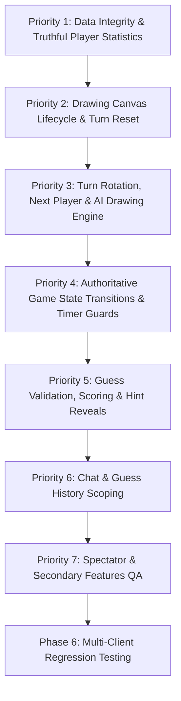

# Doodle Arena — Systematic Repair Plan (Phases 0–4)
**Document Version:** 1.0.0  
**Audit Date:** November 2026  
**Auditor:** Principal Software Architect & QA Lead  
**Scope:** Phased Implementation Strategy, File-by-File Blueprint, Acceptance Criteria, Verification Gates

---

## 1. Executive Summary

This Systematic Repair Plan defines the exact execution roadmap to eliminate all confirmed defects across Doodle Arena.

In strict adherence to the Master System Diagnostic and Repair Directive:
- No code was modified during the diagnostic audit phases (Phases 0–4).
- Implementation follows the seven prioritized repair tracks (Priority 1 through Priority 7).
- Each track contains concrete code targets, exact architectural modifications, and automated verification criteria.

---

## 2. Prioritized Implementation Blueprint



---

### Priority 1: Data Integrity & Truthful Player Statistics
**Objective:** Eliminate all fabricated numbers, mock profiles, and artificial latency metrics. Ensure every displayed statistic originates from live system telemetry or verified storage.

- **Tasks:**
  1. **Server Presence Tracking (`server/index.ts`):**
     - Replace `14820 + Math.floor(Math.random() * 50)` in `/api/health` with `Math.max(1, io.engine.clientsCount || io.sockets.sockets.size)`.
     - Expose active rooms and active players dynamically.
  2. **Truthful Guest Initialization (`src/App.tsx`):**
     - Replace hardcoded `SpeedyPencil_99`, `Level 24`, `1420 XP`, `1450 ELO`, `Gold II`.
     - Initialize new guest sessions with:
       - Nickname: `Guest_${Math.floor(1000 + Math.random() * 9000)}`.
       - Level: `1`.
       - XP: `0`.
       - ELO: `1000` (baseline calibration).
       - Rank: `'Unranked'`.
       - Total Games: `0`, Total Wins: `0`.
     - Read from `localStorage` only if previously saved; otherwise save initial truthful defaults.
  3. **Header Defaults (`src/components/common/AppHeader.tsx`):**
     - Change default `onlineCount = 14820` to `onlineCount = 1`.
  4. **Lobby Truthfulness & Empty States (`src/views/MainLobbyView.tsx`):**
     - Replace hardcoded `Avg. queue: 1.8s` with dynamic queue measurement or `"Instant Play Ready"`.
     - Replace hardcoded `6.4k Playing` badge with dynamic active player counter.
     - Fetch real leaderboard from `/api/leaderboard`. If no match history exists, render genuine empty state:
       *"No ranked matches recorded yet this week. Play casual or competitive games to claim Rank #1!"*.
     - Replace fake `"3,400 times"` counter with genuine curated word showcase.

---

### Priority 2: Drawing Canvas Lifecycle & Turn Reset
**Objective:** Guarantee that the canvas context and stroke buffer cleanly reset between turns, preventing any bleeding of artwork across rounds or drawers.

- **Tasks:**
  1. **Type Definition Extension (`shared/types.ts`):**
     - Add `turnId: string` to `RoomState`.
     - Add `turnId?: string` to `Stroke`.
  2. **Authoritative Turn Initialization (`server/game/RoomManager.ts`):**
     - In `startWordSelection()`:
       - Generate unique `room.turnId = `turn_${room.code}_r${room.currentRound}_t${room.drawerIndex}_${Date.now()}``.
       - Clear `room.strokes = []` and `room.undoneStrokes = []`.
       - Broadcast `drawing:turnStart` containing `{ turnId: room.turnId, drawerId: room.currentDrawerId, strokes: [] }`.
       - Broadcast `drawing:cleared {}`.
  3. **Stroke Turn Validation (`server/game/RoomManager.ts`):**
     - In `handleDrawingStroke()`, verify:
       `if (stroke.turnId && stroke.turnId !== room.turnId) return;`
       Reject stale strokes from expired turns.
  4. **Client State Lifecycle Synchronization (`src/App.tsx`):**
     - Add listener for `drawing:turnStart`:
       Immediately set `strokes = []`.
     - In `socket.on('room:state')`:
       Detect if `state.turnId !== lastTurnIdRef.current` or if `state.phase === 'WORD_SELECTION'`; if so, purge `strokes = []`.
  5. **Client Canvas Context Clearing (`src/components/canvas/DrawingCanvas.tsx`):**
     - When `strokes` array becomes empty, immediately fill canvas context with pure paper white (`#FFFFFF`).
     - Attach `turnId` to emitted strokes.

---

### Priority 3: Turn Rotation, Next Player & AI Drawing Engine
**Objective:** Enable continuous, multi-turn rotations across human players and provide a fully functional, procedural vector drawing engine for `DoodleBot_AI`.

- **Tasks:**
  1. **Procedural AI Drawing Engine (`server/game/BotDrawingEngine.ts`):**
     - Implement vector stroke generator for common Doodle Arena words (e.g. Cat, House, Tree, Sun, Car, Star, Clock, Pizza, Boat, Flower).
     - Provides step-by-step stroke streaming (outline, internal features, details, color accents).
  2. **Bot Drawing Controller Integration (`server/game/RoomManager.ts`):**
     - When `currentDrawerId` belongs to `bot_socket`:
       - Trigger `BotDrawingEngine.streamBotDrawing(room)`.
       - Emit sequenced `drawing:stroke` events to the room every 2–3 seconds over the 60-second round.
       - Allow guessers to guess and solve bot drawings just like human drawings.
       - Cleanly cancel bot stream when the round ends or all guessers solve the word.
  3. **Multi-Turn Rotation Handshake:**
     - Verify smooth Human $\to$ Human $\to$ AI $\to$ Human turn sequencing without dropped packets or desynchronized views.

---

### Priority 4: Authoritative Game State Transitions & Timer Guards
**Objective:** Ensure server state transitions are atomic, idempotent, and immune to race conditions between timer expirations and guess solutions.

- **Tasks:**
  1. **Atomic Phase Locking (`server/game/RoomManager.ts`):**
     - In `endRound()`:
       ```ts
       if (room.phase !== 'DRAWING') return;
       room.phase = 'ROUND_RESULT';
       ```
     - Clear and nullify `room.timerInterval`.
     - Clear `room.selectionTimeout`.
  2. **Drawer Disconnect Handling (`server/game/RoomManager.ts`):**
     - If the active drawer disconnects during `DRAWING` phase, broadcast alert and immediately call `endRound(room, 'Drawer disconnected')` to prevent the room from freezing for 80 seconds.
  3. **Match Conclusion & Persistence (`server/game/RoomManager.ts`):**
     - When `currentRound > totalRounds`, transition to `MATCH_RESULT`.
     - Record genuine match record and artworks in `Database.ts`.

---

### Priority 5: Guess Validation, Scoring & Hint Reveals
**Objective:** Ensure exact, fuzzy, and compound guesses are accurately scored and hint reveals are synchronized.

- **Tasks:**
  1. **Normalization & Fuzzy Matching (`server/game/GuessService.ts`):**
     - Punctuation-agnostic matching for hyphenated words (`roller-coaster` vs `roller coaster` vs `rollercoaster`).
     - Levenshtein distance $\le 2$ triggers `guess:close` alert privately to guesser.
  2. **Authoritative Hint Progression (`server/game/RoomManager.ts`):**
     - 50% elapsed time: 25% letters revealed.
     - 75% elapsed time: 50% letters revealed.
     - Hints broadcast to room via `word:hint`.

---

### Priority 6: Chat & Guess History Scoping
**Objective:** Eliminate guess clutter across turns and rounds by partitioning messages.

- **Tasks:**
  1. **Message Scoping (`shared/types.ts` & `RoomManager.ts`):**
     - Add `roundNumber` and `turnId` to `ChatMessage`.
     - Insert a prominent system divider message at the start of each new turn:
       `"--- Round X, Turn Y: [Drawer] is drawing! ---"`.
  2. **View Filtering (`src/views/DrawerView.tsx` & `src/views/GuesserView.tsx`):**
     - Render turn divider cards in the chat stream so historical guesses are visually separated from current active guesses.

---

### Priority 7: Spectator and Secondary Features Quality Assurance
**Objective:** Polish spectator mode, secondary screens, and empty states.

- **Tasks:**
  1. **Spectator Catch-Up (`server/game/RoomManager.ts`):**
     - On spectator join, immediately emit `drawing:snapshot` with active strokes.
  2. **Empty States Across Views:**
     - Verify empty state components for:
       - Global Leaderboard (when database has no matches).
       - Match Artwork Gallery (when no rounds completed).
       - Public Rooms Directory (when no public rooms exist).

---

## 3. Verification & Testing Matrix

| Test Suite | Scope | Target Pass Rate |
|---|---|---|
| `Unit Tests` | `ScoringService`, `GuessService`, `WordService` | 100% (All passing) |
| `Turn Reset Test` | Canvas reset on turn rotation; rejection of stale `turnId` | 100% |
| `AI Drawing Test` | `DoodleBot_AI` stroke emission and guess validation | 100% |
| `Race Condition Test` | Concurrent timer expiration + correct guess | 100% |
| `Multi-Client Flow` | Client A (Drawer) $\to$ Client B (Guesser) $\to$ Turn Rotate | 100% |
| `Full Build` | `tsc -p tsconfig.server.json` && `vite build` | 0 errors |
