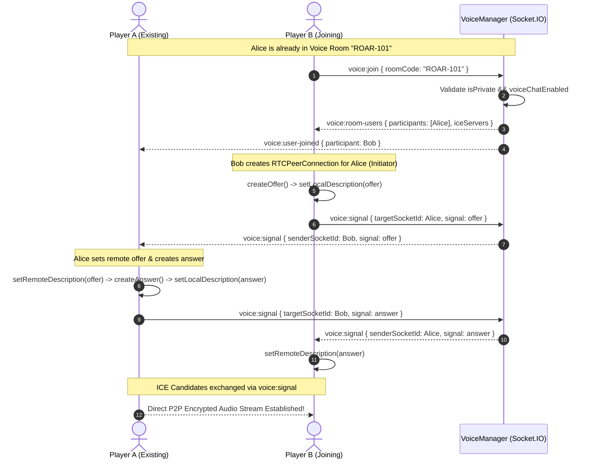

# Doodle Arena: WebRTC Mesh Audio Architecture

## 1. Network Topology: Peer-to-Peer Full Mesh

For private game rooms with 2 to 8 players, Doodle Arena utilizes a **Peer-to-Peer (P2P) Full Mesh WebRTC topology**. 

```
                          [ Socket.IO Signaling Server ]
                                (Metadata Relay Only)
                                ╱         │         ╲
                     Signaling ╱          │ Signaling╲ Signaling
                              ▼           ▼           ▼
                         [Player A] ◄═══════════► [Player B]
                             ▲ ╲      P2P Audio      ╱ ▲
                             ║  ╲                   ╱  ║
                   P2P Audio ║   ╲═════► [Player C] ◄═╝  ║ P2P Audio
                             ║            ▲            ║
                             ╚════════════╩════════════╝
```

### Architectural Rationale:
1. **Zero Media Server Overhead:** Audio streams travel directly between player browsers without passing through backend servers, dramatically reducing server bandwidth, memory consumption, and cloud infrastructure costs.
2. **Sub-100ms Ultra-Low Latency:** Direct browser-to-browser UDP packet transmission achieves real-time conversational audio without relay buffering.
3. **End-to-End Encryption:** All WebRTC media streams are natively encrypted via DTLS/SRTP.

---

## 2. Signaling Protocol Specification

Socket.IO acts as the secure signaling channel for ICE candidate exchange and SDP negotiation.



---

## 3. ICE & STUN/TURN Configuration

NAT traversal is handled via standard Interactive Connectivity Establishment (ICE):

- **Default STUN:** `stun:stun.l.google.com:19302`
- **Optional Enterprise TURN Configuration:**
  Configurable via server environment variables:
  - `STUN_SERVER`: Custom STUN URL
  - `TURN_SERVER`: TURN endpoint URL (e.g. Coturn / Twilio)
  - `TURN_USERNAME`: Authentication username
  - `TURN_PASSWORD`: Secret credential

---

## 4. Web Audio API Speaking Activity Detection

Speaking detection is evaluated locally in the browser to minimize network signaling overhead:

1. `AudioContext` and `AnalyserNode` analyze the microphone `MediaStream`.
2. The frequency domain data buffer ($512$ FFT bins) calculates an average energy level every 100ms.
3. When the energy surpasses an amplitude threshold ($> 18$), the local state immediately updates `isSpeaking: true` and broadcasts `voice:speaking { isSpeaking: true }`.
4. A 400ms decay window prevents indicator flickering between syllables and pauses.
